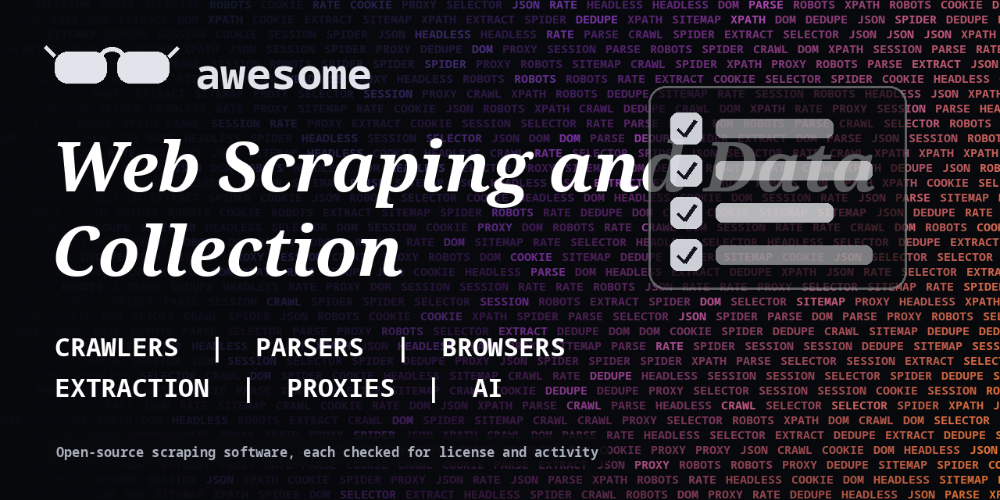

<h1 align="center">Awesome Web Scraping and Data Collection</h1>

> Open-source crawlers, scraping frameworks, parsers, browser tools and data extraction with AI. Every entry shows its license.

**Rules of this list:** every repo exists, is public, is not archived, states a license and has had a commit in the last year. One plain sentence each. Star counts and claims are the authors' own, we did not test every tool. Checked 2026-10-18. See [CONTRIBUTING.md](CONTRIBUTING.md).

## Contents

- [Crawling frameworks](#crawling-frameworks)
- [Parsers and extractors](#parsers-and-extractors)
- [Browser-based scraping](#browser-based-scraping)
- [AI and LLM extraction](#ai-and-llm-extraction)
- [Scraping APIs and self-hosted services](#scraping-apis-and-self-hosted-services)
- [Proxies and rotation](#proxies-and-rotation)
- [Datasets and archives](#datasets-and-archives)
- [Change monitoring](#change-monitoring)
- [How to choose](#how-to-choose)
- [Contributing](#contributing)

## Crawling frameworks

Fast crawlers with queues and retries.

- [apify/crawlee](https://github.com/apify/crawlee)  - Web scraping and browser automation library for Node.js. _(Apache-2.0)_
- [gocolly/colly](https://github.com/gocolly/colly)  - Fast and elegant scraping framework for Go. _(Apache-2.0)_
- [scrapy/scrapy](https://github.com/scrapy/scrapy)  - Fast Python framework for crawling sites and extracting data. _(BSD-3-Clause)_

## Parsers and extractors

Pull structured data out of HTML and documents.

- [adbar/trafilatura](https://github.com/adbar/trafilatura)  - Python tool to gather text and metadata from the web. _(Apache-2.0)_
- [camelot-dev/camelot](https://github.com/camelot-dev/camelot)  - Extract tables from PDF files. _(MIT)_
- [cheeriojs/cheerio](https://github.com/cheeriojs/cheerio)  - Fast jQuery-like HTML parsing for Node.js. _(MIT)_
- [codelucas/newspaper](https://github.com/codelucas/newspaper)  - News and article extraction and curation in Python. _(MIT)_
- [jhy/jsoup](https://github.com/jhy/jsoup)  - Java HTML parser with a jQuery-like API. _(MIT)_
- [jsvine/pdfplumber](https://github.com/jsvine/pdfplumber)  - Extract text and tables from PDFs. _(MIT)_
- [lxml/lxml](https://github.com/lxml/lxml)  - Python bindings for libxml2 and libxslt. _(BSD-3-Clause)_
- [mozilla/readability](https://github.com/mozilla/readability)  - Standalone version of the Firefox Reader View library. _(Apache-2.0)_
- [scrapy/parsel](https://github.com/scrapy/parsel)  - Extract data from HTML and XML with XPath and CSS selectors. _(BSD-3-Clause)_

## Browser-based scraping

Handle JavaScript sites.

- [browserless/browserless](https://github.com/browserless/browserless)  - Headless browser service for automation and scraping. _(check repo)_
- [daijro/camoufox](https://github.com/daijro/camoufox)  - Anti-detect browser for scraping, built on Firefox. _(MPL-2.0)_
- [Kaliiiiiiiiii-Vinyzu/patchright](https://github.com/Kaliiiiiiiiii-Vinyzu/patchright)  - Undetected version of Playwright. _(Apache-2.0)_
- [microsoft/playwright](https://github.com/microsoft/playwright)  - Browser automation across Chromium, Firefox and WebKit. _(Apache-2.0)_
- [puppeteer/puppeteer](https://github.com/puppeteer/puppeteer)  - JavaScript API to control Chrome and Firefox. _(Apache-2.0)_
- [SeleniumHQ/selenium](https://github.com/SeleniumHQ/selenium)  - Browser automation framework and ecosystem. _(Apache-2.0)_

## AI and LLM extraction

Turn pages into clean text or JSON for models.

- [browser-use/browser-use](https://github.com/browser-use/browser-use)  - Make websites accessible for AI agents. _(MIT)_
- [firecrawl/firecrawl](https://github.com/firecrawl/firecrawl)  - Turn websites into clean markdown or structured data for language models. _(AGPL-3.0)_
- [firecrawl/firecrawl](https://github.com/firecrawl/firecrawl)  - Turn websites into clean data for language models. _(AGPL-3.0)_
- [jina-ai/reader](https://github.com/jina-ai/reader)  - Convert any URL into LLM-friendly text. _(Apache-2.0)_
- [microsoft/markitdown](https://github.com/microsoft/markitdown)  - Convert files and office documents to Markdown. _(MIT)_
- [ScrapeGraphAI/Scrapegraph-ai](https://github.com/ScrapeGraphAI/Scrapegraph-ai)  - Python scraper that uses language models and graph logic. _(MIT)_
- [unclecode/crawl4ai](https://github.com/unclecode/crawl4ai)  - Open-source web crawler and scraper made for AI use. _(Apache-2.0)_

## Scraping APIs and self-hosted services

Run your own scraping API.

- [DIYgod/RSSHub](https://github.com/DIYgod/RSSHub)  - Generate RSS feeds from almost anything. _(AGPL-3.0)_
- [FreshRSS/FreshRSS](https://github.com/FreshRSS/FreshRSS)  - Self-hosted RSS feed aggregator. _(AGPL-3.0)_
- [huginn/huginn](https://github.com/huginn/huginn)  - Build agents that watch the web and act on your behalf. _(MIT)_
- [RSSHub/RSSHub](https://github.com/RSSHub/RSSHub)  - Generate RSS feeds from almost anything. _(AGPL-3.0)_

## Proxies and rotation

Manage IPs and request headers.

- [bogdanfinn/tls-client](https://github.com/bogdanfinn/tls-client)  - Go HTTP client with browser TLS fingerprints. _(BSD-4-Clause)_
- [encode/httpx](https://github.com/encode/httpx)  - Fully featured HTTP client for Python. _(BSD-3-Clause)_
- [jhao104/proxy_pool](https://github.com/jhao104/proxy_pool)  - Python crawler proxy IP pool. _(MIT)_
- [lexiforest/curl_cffi](https://github.com/lexiforest/curl_cffi)  - Python binding for curl-impersonate, with browser TLS fingerprints. _(MIT)_
- [psf/requests](https://github.com/psf/requests)  - Simple HTTP library for Python. _(Apache-2.0)_

## Datasets and archives

Archive pages and keep copies.

- [ArchiveBox/ArchiveBox](https://github.com/ArchiveBox/ArchiveBox)  - Self-hosted internet archiving, saves pages in many formats. _(MIT)_
- [commoncrawl/cc-pyspark](https://github.com/commoncrawl/cc-pyspark)  - Process Common Crawl data with Apache Spark and Python. _(MIT)_
- [gildas-lormeau/SingleFile](https://github.com/gildas-lormeau/SingleFile)  - Browser extension and CLI to save a complete page as one HTML file. _(AGPL-3.0)_
- [internetarchive/heritrix3](https://github.com/internetarchive/heritrix3)  - Internet Archive's open-source web crawler. _(check repo)_
- [webrecorder/browsertrix-crawler](https://github.com/webrecorder/browsertrix-crawler)  - Run a high-fidelity browser-based crawler in a single Docker container. _(AGPL-3.0)_
- [webrecorder/pywb](https://github.com/webrecorder/pywb)  - Python web archiving toolkit for replaying archived sites. _(GPL-3.0)_

## Change monitoring

Watch pages and get alerts.

- [dgtlmoon/changedetection.io](https://github.com/dgtlmoon/changedetection.io)  - Watch web pages for changes and get alerts, self-hosted. _(Apache-2.0)_
- [louislam/uptime-kuma](https://github.com/louislam/uptime-kuma)  - Self-hosted uptime monitoring tool. _(MIT)_

## How to choose

- **Read robots.txt and the site's terms.** Some sites forbid scraping.
- **Be gentle.** Rate limit your requests and cache pages.
- **Personal data is regulated.** Check GDPR and local law before you collect it.
- **Prefer an official API** when one exists.

## Contributing

See [CONTRIBUTING.md](CONTRIBUTING.md). One entry per pull request, plain words, real sources only.

## About

Maintained by [@devanasolver](https://github.com/devanasolver). Listings follow the rules in CONTRIBUTING.

## Sponsor me

If this list is useful, [buy me a coffee](https://buymeacoffee.com/isaac49).
